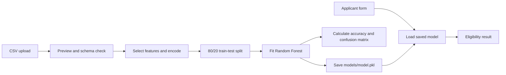
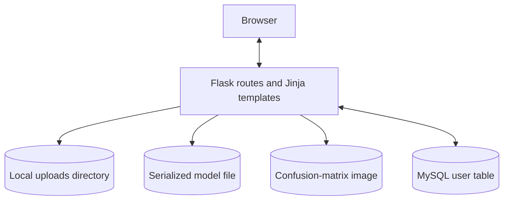
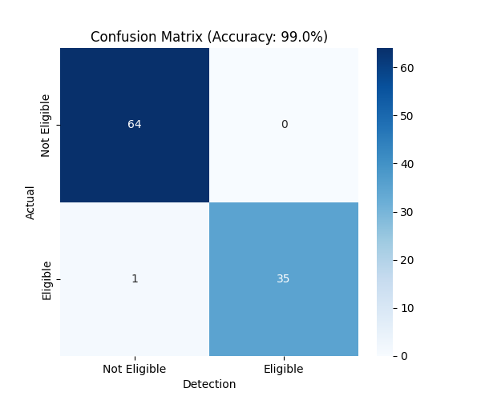

# Loan Eligibility Prediction


A Flask-based machine-learning web application developed as an Ideonix Internship Project. It accepts a loan dataset, trains a classifier to predict loan eligibility, and provides a form for making individual predictions.

## Table of Contents

- [Project Overview](#project-overview)
- [Problem Statement and Objectives](#problem-statement-and-objectives)
- [Features](#features)
- [Technology Stack](#technology-stack)
- [Machine Learning Workflow](#machine-learning-workflow)
- [Architecture](#architecture)
- [Application Workflow](#application-workflow)
- [Project Structure](#project-structure)
- [Dataset](#dataset)
- [Model and Evaluation](#model-and-evaluation)
- [Requirements and Setup](#requirements-and-setup)
- [Running the Application](#running-the-application)
- [Using the Application](#using-the-application)
- [Results and Visual Artifact](#results-and-visual-artifact)
- [Limitations and Future Enhancements](#limitations-and-future-enhancements)
- [Learning Outcomes](#learning-outcomes)
- [Author](#author)
- [License](#license)

## Project Overview

The application brings together a small Flask web interface and a scikit-learn training and inference flow. A user can register and log in, upload a CSV file, preview its first rows, train a model, and enter applicant details to receive an eligibility classification.

The project stores account records in a MySQL database. Uploaded datasets, the serialized model, and the generated confusion-matrix image are stored as local files.

## Problem Statement and Objectives

Loan eligibility decisions depend on several applicant and loan attributes. This project demonstrates how those attributes can be used in a supervised classification workflow and exposed through a browser-based interface.

Project objectives:

- Accept a loan dataset in CSV format and preview its contents.
- Train a classifier using selected applicant and loan attributes.
- Report held-out accuracy and generate a confusion matrix after training.
- Accept one applicant record through a web form and display a predicted class.
- Provide basic account registration and login backed by MySQL.

## Features

- Registration and login, with submitted passwords hashed using Flask-Bcrypt.
- CSV upload and a preview of up to 10 rows.
- Dataset validation for the target and feature columns required by the training code.
- Random Forest training and serialization to `models/model.pkl`.
- Accuracy reporting and confusion-matrix image generation during training.
- A single-record eligibility form and results page.
- Server-rendered pages styled with a local stylesheet and Bootstrap CSS loaded from a CDN.

## Technology Stack

| Area | Technologies present in the project |
| --- | --- |
| Language and web framework | Python, Flask, Jinja templates |
| Data and machine learning | pandas, NumPy, scikit-learn, joblib |
| Evaluation and visualization | scikit-learn metrics, Matplotlib, Seaborn |
| Persistence and password hashing | Flask-SQLAlchemy, MySQL through PyMySQL, Flask-Bcrypt |
| Front end | HTML, CSS, Bootstrap 5.0.2 stylesheet via CDN |

The repository does not include a dependency manifest or a pinned Python version. The install commands below are derived from the imports and database driver used in `app.py`.

## Machine Learning Workflow

1. Upload a CSV file. The upload route saves it under `uploads/` and previews its first 10 rows.
2. Training checks for `Loan_Status` and selects the eight features listed below.
3. `Loan_Status` is mapped to `1` when its string value is `Y` (case-insensitive, with surrounding whitespace removed); other values are mapped to `0`.
4. Object-valued selected features are transformed with scikit-learn's `LabelEncoder`. Feature values are converted to numeric values, with conversion failures replaced by `0`.
5. The data is split into training and test subsets using an 80/20 split and `random_state=42`.
6. A `RandomForestClassifier` with 100 estimators and `random_state=42` is fit on the training subset.
7. The model is saved to `models/model.pkl`. The test subset is used to calculate accuracy and create a confusion matrix.
8. The prediction route loads that saved model and predicts a class from the eight form values.



## Architecture



The Flask routes coordinate both the web pages and the ML operations. User records use the configured SQLAlchemy database; uploaded CSVs, the trained model, and the plot are file-based. The training route uses the uploaded dataframe held in the running Flask process, so upload and training are expected to happen in the same app process.

## Application Workflow

1. Open the home page and register an account, or sign in with an existing account.
2. From the dashboard, choose the loan-eligibility workflow.
3. Upload a CSV file and review the displayed preview.
4. Select **Train Model** to train and save the classifier.
5. Select **Detect**, enter the requested applicant details, and submit the form.
6. Review the predicted eligibility label and the submitted values.

The dashboard route checks for a logged-in session. The upload, training, and detection routes do not currently enforce that session check.

## Project Structure

```text
.
├── app.py                         # Flask routes, database model, upload, training, and prediction logic
├── Loan_Eligibility.csv           # Included dataset (500 data rows)
├── models/
│   └── model.pkl                  # Serialized model artifact
├── static/
│   ├── css/
│   │   └── style.css              # Application styles
│   └── images/
│       ├── confusion_matrix.png   # Existing training-plot artifact
│       ├── images.jpg             # Referenced as the page background
│       ├── img.jpg                # Image asset; purpose not established by app.py
│       └── My First Blog.html     # Standalone HTML file, not used by the Flask routes
├── templates/
│   ├── base.html                  # Shared page layout and flash messages
│   ├── index.html                 # Home page
│   ├── login.html                 # Login form
│   ├── register.html              # Registration form
│   ├── dashboard.html             # Signed-in dashboard
│   ├── upload.html                # CSV upload and preview
│   ├── train.html                 # Training result view
│   ├── detect.html                # Applicant input form
│   └── result.html                # Prediction result
└── uploads/
    └── Loan_Eligibility.csv       # Upload-directory copy of the included dataset
```

The root and `uploads/` CSV files are identical in the current workspace. Files under `uploads/` can be replaced when a CSV with the same filename is uploaded.

## Dataset

The repository includes `Loan_Eligibility.csv`, which contains 500 data rows and 12 columns. The same dataset is also present under `uploads/`. Its origin and collection methodology are not documented in the repository.

| Column | Role in the current training code |
| --- | --- |
| `Gender` | Present in dataset; not selected for training |
| `Married` | Present in dataset; not selected for training |
| `Dependents` | Selected feature |
| `Education` | Present in dataset; not selected for training |
| `Employment_Type` | Selected feature |
| `ApplicantIncome` | Selected feature |
| `CoapplicantIncome` | Selected feature |
| `LoanAmount` | Selected feature |
| `Loan_Term_Months` | Selected feature |
| `Credit_History` | Selected feature |
| `Property_Area` | Selected feature |
| `Loan_Status` | Target (`Y` becomes 1; other values become 0) |

Training expects all eight selected feature columns and `Loan_Status`. A CSV that only has a different or partial schema will not satisfy the current training code.

## Model and Evaluation

The training route creates a scikit-learn `RandomForestClassifier` with `n_estimators=100` and `random_state=42`. It evaluates the fitted model on the 20% test split using accuracy and a confusion matrix. No cross-validation or additional metrics are implemented in the current training route.

The prediction form submits these features: `ApplicantIncome`, `CoapplicantIncome`, `LoanAmount`, `Loan_Term_Months`, `Credit_History`, `Employment_Type`, `Dependents`, and `Property_Area`.

**Encoding caveat:** training applies `LabelEncoder` to object-valued features, but the prediction form submits manually assigned integer option values. The form's `Employment_Type` codes are not in the alphabetical order that `LabelEncoder` uses for the dataset's text labels. The app does not persist or reuse fitted encoders, so this category can be encoded inconsistently between training and prediction. Treat predictions accordingly until the encoding is made consistent.

The checked-in `models/model.pkl` is a serialized artifact, but the repository does not record which dataset or training run produced it. Running the training workflow replaces it.

## Requirements and Setup

### Prerequisites

- Python installed and available as `python` (the project does not specify a supported Python version).
- MySQL server available locally.
- A MySQL database named `ml_app` and connection settings configured for the local environment.
- Internet access when loading the Bootstrap stylesheet from its CDN.

The application currently defines its database connection directly in `app.py`; update that configuration for your local MySQL instance before running. Do not commit real credentials or secret keys. The repository does not currently provide environment-variable configuration or a `.env` file.

### Create a virtual environment

From the project root, in Windows PowerShell:

```powershell
py -m venv .venv
.\.venv\Scripts\Activate.ps1
python -m pip install --upgrade pip
```

Install the packages imported by the application:

```powershell
python -m pip install Flask Flask-SQLAlchemy Flask-Bcrypt pandas numpy scikit-learn joblib matplotlib seaborn PyMySQL
```

Create the MySQL database before starting the application:

```sql
CREATE DATABASE ml_app;
```

On startup, `app.py` calls `db.create_all()` to create the configured user table. Dependency versions are not pinned in this repository.

## Running the Application

Start the Flask development server from the project root:

```powershell
python app.py
```

Then open [http://127.0.0.1:5000](http://127.0.0.1:5000). The application is configured to listen on port `5000` and all host interfaces. Running from the project root is important because model and plot paths are relative to the working directory.

## Using the Application

- Register or log in to reach the dashboard.
- Upload a `.csv` file. The upload handler accepts the CSV extension and displays at most the first 10 records.
- Train using a dataset with the required columns described above.
- After training, use the detection form to submit the eight feature values and view the predicted label.

The form provides choices for credit history, employment type, dependents, and property area, and numeric inputs for income, loan amount, and term. Its numeric limits and display labels are defined in `templates/detect.html`.

## Results and Visual Artifact

The training route reports an accuracy percentage and writes a confusion-matrix plot when training completes. The exact score depends on the uploaded dataset and the current split; this README does not claim a fixed result. No verified benchmark report or application UI screenshots are included in the repository. The existing image below is the confusion-matrix artifact, not a product screenshot; it may reflect a previous training run.



## Limitations and Future Enhancements

- Use a fitted preprocessing pipeline so categorical encoders are persisted and shared by training and prediction.
- Move database settings and Flask's secret key to environment-based configuration.
- Add consistent authentication and authorization checks to upload, training, and prediction routes.
- Add upload-size limits, stronger CSV/schema validation, and clearer input error handling.
- Add dependency/version management and automated tests for routes, preprocessing, and prediction.
- Record dataset provenance and repeatable evaluation results before publishing model-quality claims.
- Add genuine screenshots of the running application if portfolio screenshots are desired.

These are suggested improvements, not features currently implemented by the project.

## Learning Outcomes

The code demonstrates practical work with Flask routes and Jinja templates, form handling and CSV uploads, SQLAlchemy-backed user records, password hashing, pandas preprocessing, scikit-learn model training and evaluation, joblib serialization, and Matplotlib/Seaborn visualization.

## Author

**Ideonix Internship Project**  
The author's name and profile are not identified in the repository. Add the preferred name and portfolio or GitHub link here before publishing.

## License

No license file or license declaration is present in the repository. The project's reuse and distribution terms need to be confirmed by the author.